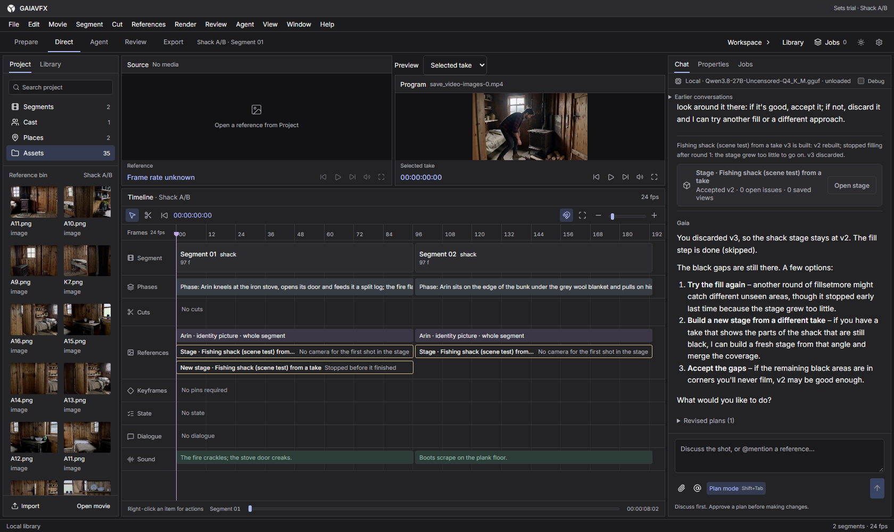
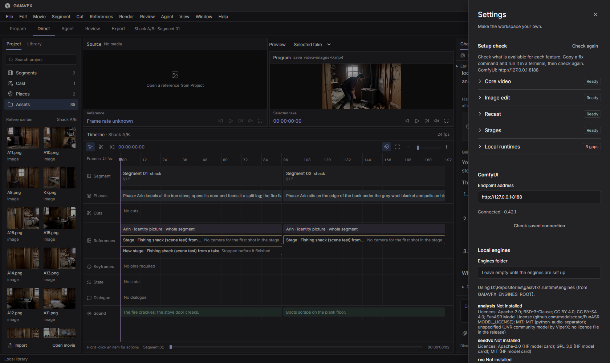

<picture>
  <source media="(prefers-color-scheme: dark)" srcset="assets/brand/svg/wordmark-white.svg">
  <source media="(prefers-color-scheme: light)" srcset="assets/brand/svg/wordmark-black.svg">
  
</picture>

GAIAVFX is a local-first, chat-first movie workspace driven by ComfyUI. Discuss a film with Gaia, the chat agent: in plan mode, Gaia proposes a plan and executes it after your approval, with results landing on shared tracks. ComfyUI runs the image and video model graphs locally; the assistant and stage engine also run locally. You stay the director and pick the final takes.

[Install reference](docs/INSTALL.md) · [Architecture](docs/ARCHITECTURE.md) · [Contributing](AGENTS.md)



## What you can do

- **Prepare:** make reference plates, views and sheets.
- **Direct:** arrange shots and cuts on shared tracks.
- **Agent:** discuss the work, revise a plan, then approve its execution.
- **Review:** rank candidates blind before selecting takes.
- **Stages:** build a 3D stage from a generated take with gsplat, fill unseen space and use stage views in scenes. Research-grade; requires the separate worldbuilder engine.
- **Recast:** replace one or two characters across a film's shots, with human review.
- **Image edits:** use Qwen-Image-Edit-2511 with its Lightning adapter.

Voice conversion is experimental and requires manual engine setup.

## Built with ComfyUI, open weights only

MiniMax H3 is the core video model. Every ComfyUI graph is built in Python by typed integrations and submitted through ComfyUI's API. The app maintains [one custom node pack](comfy_nodes/gaiavfx) with nine nodes and installs four pinned third-party packs. All model weights in the setup manifest are open weights, with the individual licence restrictions below.

The supplied launchers run ComfyUI with `--disable-api-nodes`: no partner or API nodes and no cloud model APIs are needed. Gaia runs a local Qwen GGUF through llama.cpp, or any OpenAI-compatible **local** server configured in Settings. This is the setup for the ComfyUI “Open Source Higgsfield” challenge's **Open Weights Only** entry and **Built with MiniMax H3** bonus.

## Requirements and verified runs

Windows is the primary platform. Tested on **Windows 11, RTX 4090 24 GB, 64 GB RAM**, with **ComfyUI 0.42.1 portable** and `--lowvram --reserve-vram 4 --disable-api-nodes`. These are tested specifications, not minimum requirements. Install Git, uv and Node.js **24+** (including npm); the installer provisions Python 3.12 for the app. Linux x86-64 via `install.sh` is best effort. The bundled Linux llama.cpp server is CPU-only unless you build it with CUDA or choose another local server.

| Model feature group | Disk for weights |
|---|---:|
| core | 59.1 GiB |
| image-edit | 28.9 GiB |
| recast | 61.1 GiB |
| stages | 66.1 GiB |
| All 18 files, shared files counted once | **95.3 GiB (102.4 GB)** |

Leave additional space for ComfyUI, download archives, Python environments, generated media and the assistant (about 18.4 GB of model/projector files).

On 29 October 2026, a fresh install using our CLI downloaded the official 2.0 GB portable archive, verified its SHA-256 and extracted it with Windows' built-in tar. Node installation took 40 s, including insightface and onnxruntime. Recast downloaded buffalo_l (196 MB, SHA verified) and reused other weights through `extra_model_paths.yaml`. Doctor reported core, image-edit and recast ready (146 checks ok). `engines install worldbuilder` then provisioned the stage engine (Python 3.10, torch 2.4.1 cu124, gsplat 1.5.3; a CUDA gsplat rasterization ran on the RTX 4090), after which doctor and the in-app Setup check reported all four features ready. A fresh `git clone` followed by `install.ps1 -ComfyDir … -SkipModels -NonInteractive` completed and ended with the doctor summary.

Real GPU smoke runs on that fresh ComfyUI:

| Feature | Run time | Output |
|---|---:|---|
| core — H3, 5 frames, tiny | 16.5 s | mp4 |
| image-edit — Qwen-Image-Edit-2511 Lightning | 13.1 s | png |
| stages — DA3 + SAM3 + GaiaSaveSetGeometry | 3.1 s | npz |

These prove the node, model and graph contract, **not output quality**. The stages smoke checks geometry extraction, not a complete gsplat stage build.

## Quick start

From the repository root in PowerShell, choose **one** install command. Review the model licences before downloading. The first command downloads core and image-edit weights plus the local assistant and stages engine; the second reuses an existing ComfyUI and defers model downloads.

```powershell
.\install.ps1 -InstallComfy (Join-Path (Split-Path $PWD -Parent) 'ComfyUI') -Features core,image-edit -NonInteractive
# Or, with your existing ComfyUI:
.\install.ps1 -ComfyDir 'C:\ComfyUI' -Features core,image-edit -SkipModels -NonInteractive

$env:GAIAVFX_LIBRARY = 'C:\GAIAVFX-Library'
.\start.ps1 -WithComfy -ComfyArgs '--lowvram','--reserve-vram','4'
```

The assistant and stages engine install by default. Include `stages` in `-Features` for its ComfyUI weights. `-SkipModels` skips only ComfyUI weights. Interactive setup defaults to the saved ComfyUI folder when it still contains ComfyUI, otherwise a fresh install in `<repo parent>/ComfyUI` and Yes for model, assistant and engine downloads. Non-interactive setup reuses a valid saved folder; otherwise pass `-ComfyDir` or `-InstallComfy` to install or use ComfyUI.

| PowerShell | Linux / Python installer | Effect |
|---|---|---|
| `-SkipAssistant` | `--skip-assistant` | Skip the assistant; configure an existing local endpoint in Settings or install later. |
| `-SkipStagesEngine` | `--skip-stages-engine` | Skip the worldbuilder stages engine. |
| `-SkipModels` | `--skip-models` | Skip ComfyUI weights only. |
| `-WithAssistant` / `-WithStagesEngine` | `--with-assistant` / `--with-stages-engine` | Deprecated no-ops; each prints a note. Skip flags take precedence. |

Linux equivalents:

```bash
bash install.sh --install-comfy "$(dirname "$PWD")/ComfyUI" --features core image-edit --non-interactive
# Or, with your existing ComfyUI:
bash install.sh --comfy-dir /opt/ComfyUI --features core image-edit --skip-models --non-interactive

export GAIAVFX_LIBRARY="$HOME/GAIAVFX-Library"
bash start.sh --with-comfy --lowvram --reserve-vram 4
```

The installer checks prerequisites, installs locked app dependencies, installs verified FFmpeg tools, builds the renderer, installs or connects ComfyUI, installs node packs and selected weights, then installs the assistant and stages engine unless skipped and prints doctor findings. It saves defaults in `.runtime/setup.json`. It does not start inference services. Start without `-WithComfy` / `--with-comfy` if ComfyUI is already running; a separately launched ComfyUI must be stopped separately.

In a second terminal, verify after ComfyUI has started:

```powershell
npm run doctor
.venv\Scripts\Activate.ps1
python -m gaiavfx.setup smoke --feature core
```

On Linux, activate with `source .venv/bin/activate` before the same Python command. Doctor is read-only; smoke **runs GPU inference** and saves a report and output under `.runtime/smoke/`. If you changed ports, pass `--comfy-url` to smoke. Doctor checks all feature groups by default, so deferred features will remain incomplete.

On first run, create a library outside the checkout, open **Settings → Setup check**, and resolve missing items for the features you need. Existing libraries keep their own connection settings.



## Existing ComfyUI and model folders

`-ComfyDir` adopts an existing installation. To install only node packs after app setup, use the activated app environment:

```powershell
python -m gaiavfx.setup nodes install --comfy-dir 'C:\ComfyUI'
```

Point ComfyUI's `extra_model_paths.yaml` at shared model folders before installing weights. The downloader reuses matching files and writes missing files to the first configured folder. See the [YAML example and CLI reference](docs/INSTALL.md). The face nodes require buffalo_l in `ComfyUI/models/insightface/models/buffalo_l`; they ignore extra model paths. Restart ComfyUI after installing nodes or changing paths.

## Models and node packs

The default assistant is [Swift 1.5 Qwen3.8-27B Q4_K_M](https://huggingface.co/ukisai/Swift-1.5-Qwen3.8-27B-GGUF), an UkisAI finetune, with its F16 vision projector (about 18.4 GB together). It uses pinned llama.cpp b10549. UkisAI's contributions use Swift Open License v1.0: free for individuals and organisations under US$1M gross annual revenue; above that, a separate enterprise licence is required. The base uses Apache-2.0. Review the publisher's licence before downloading.

The public Unsloth Qwen3.8-27B UD-Q4_K_M base and projector remain available under Apache-2.0 (about 17.4 GB). Select them with `python -m gaiavfx.setup assistant install --model qwen3.8-base`; `--model swift-1.5` selects the default. The base model has not been run with GAIAVFX.

On 29 October 2026, Swift 1.5 ran on the RTX 4090 with the app's own llama-server flags (32k context, q8_0 KV cache, flash attention): the model and projector loaded in 21.7 GB of VRAM and answered a text and an image request. On the agent's stage evaluation (nine scripted tasks, real local model, fake ComfyUI) it passed 8 of 9 tasks with no provider or context failures; the failing task is a known fixture issue.

The tables below come from [the setup manifest](backend/src/gaiavfx/setup/manifest/comfy.toml); regenerate with `python scripts/update_readme_models.py`. Folder names are relative to `ComfyUI/models` unless mapped by extra model paths.

You must accept each model's licence, including the MiniMax H3 community licence, SAM licence and InsightFace's non-commercial research terms. **Open weights does not mean unrestricted use. GAIAVFX's GPL-3.0-or-later licence does not cover model weights.** NativeAudioLock is installed from the author's public repository, has no declared upstream licence, and is never vendored here. Motion Context is pinned to the tested v0.6.2 revision.

<details>
<summary>Model files, sizes, features, licences and sources</summary>

<!-- setup-models:start -->
| File | Folder | Size | Features | Licence | Source |
|---|---|---:|---|---|---|
| `minimax_h3_ref2va_pruned_int8_convrot.safetensors` | `diffusion_models` | 19.53 GiB | core, recast, stages | minimax-h3-community-license-agreement | [repo](https://huggingface.co/Comfy-Org/MiniMax-H3) |
| `minimax_h3_fl2va_pruned_int8_convrot.safetensors` | `diffusion_models` | 19.53 GiB | core, recast, stages | minimax-h3-community-license-agreement | [repo](https://huggingface.co/Comfy-Org/MiniMax-H3) |
| `qwen3vl_32b_minimax_h3_nvfp4_awq.safetensors` | `text_encoders` | 14.61 GiB | core, recast, stages | minimax-h3-community-license-agreement | [repo](https://huggingface.co/Comfy-Org/MiniMax-H3) |
| `minimax_h3_video_vae_fp16.safetensors` | `vae` | 4.85 GiB | core, recast, stages | minimax-h3-community-license-agreement | [repo](https://huggingface.co/Comfy-Org/MiniMax-H3) |
| `minimax_h3_audio_vae_fp32.safetensors` | `vae` | 577.2 MiB | core, recast, stages | minimax-h3-community-license-agreement | [repo](https://huggingface.co/Comfy-Org/MiniMax-H3) |
| `qwen_image_edit_2511_fp8mixed.safetensors` | `diffusion_models` | 19.12 GiB | image-edit | apache-2.0 | [repo](https://huggingface.co/Comfy-Org/Qwen-Image-Edit_ComfyUI) |
| `Qwen-Image-Edit-2511-Lightning-4steps-V1.0-bf16.safetensors` | `loras` | 810.2 MiB | image-edit | apache-2.0 | [repo](https://huggingface.co/lightx2v/Qwen-Image-Edit-2511-Lightning) |
| `qwen_2.5_vl_7b_fp8_scaled.safetensors` | `text_encoders` | 8.74 GiB | image-edit | apache-2.0 | [repo](https://huggingface.co/Comfy-Org/Qwen-Image_ComfyUI) |
| `qwen_image_vae.safetensors` | `vae` | 242.0 MiB | image-edit | apache-2.0 | [repo](https://huggingface.co/Comfy-Org/Qwen-Image_ComfyUI) |
| `sam3.1_multiplex_fp16.safetensors` | `checkpoints` | 1.63 GiB | recast, stages | sam-license | [repo](https://huggingface.co/Comfy-Org/sam3) |
| `h3_character_swap_pro4500_1000.safetensors` | `loras` | 147.9 MiB | recast | minimax-h3-community-license-agreement | [repo](https://huggingface.co/akatz-ai/MiniMax-H3-Character-Swap-LoRA) |
| `SS_FaceSwap_MiniMax_H3_REF2VA.safetensors` | `loras` | 62.6 MiB | recast | apache-2.0 | [repo](https://huggingface.co/UntMods/FaceSwap_MiniMaxH3_REF2VA) |
| `depth_anything_3_base.safetensors` | `geometry_estimation` | 516.4 MiB | stages | apache-2.0 | [repo](https://huggingface.co/Comfy-Org/Depth-Anything-3) |
| `moge_2_vitl_normal_fp16.safetensors` | `geometry_estimation` | 631.2 MiB | stages | mit | [repo](https://huggingface.co/Comfy-Org/MoGe) |
| `minimax_h3_fun_controlnet_union_2.0_pruned_int8_convrot.safetensors` | `model_patches` | 4.22 GiB | stages | minimax-h3-community-license-agreement | [repo](https://huggingface.co/Comfy-Org/MiniMax-H3) |
| `det_10g.onnx` | `insightface/models/buffalo_l` | 16.1 MiB | recast | InsightFace pretrained models: non-commercial research; separate licensing for other use | [repo](https://huggingface.co/vjump21848/buffalo_l_unzip) |
| `w600k_r50.onnx` | `insightface/models/buffalo_l` | 166.3 MiB | recast | InsightFace pretrained models: non-commercial research; separate licensing for other use | [repo](https://huggingface.co/vjump21848/buffalo_l_unzip) |
| `2d106det.onnx` | `insightface/models/buffalo_l` | 4.8 MiB | recast | InsightFace pretrained models: non-commercial research; separate licensing for other use | [repo](https://huggingface.co/vjump21848/buffalo_l_unzip) |
<!-- setup-models:end -->

</details>

<!-- setup-packs:start -->
| Node pack | Pinned revision | Features | Licence |
|---|---|---|---|
| [gaiavfx](comfy_nodes/gaiavfx) | `0.1.0` | core, recast, stages | GPL-3.0-or-later |
| [ComfyUI-H3-Motion-Context](https://github.com/NikoDemon80/ComfyUI-H3-Motion-Context) | `5335715abe54c1a9bfbe3494da29aae3e8635ce3` | core, recast | GPL-3.0 (LICENSE file) |
| [ComfyUI-H3-NativeAudioLock](https://github.com/Shrek3OnVH5/MiniMax-H3-NativeAudio-MusicVideo-Workflow) | `11a95f623b98496923714db99da0aecec672cbd4` | recast | NO LICENSE DECLARED |
| [ComfyUI-KJNodes](https://github.com/kijai/ComfyUI-KJNodes) | `6ab7e8130e449ed2c0037589bcf84146ceb7fc9c` | core, recast, stages | GPL-3.0 (LICENSE file) |
| [ComfyUI-VideoHelperSuite](https://github.com/Kosinkadink/ComfyUI-VideoHelperSuite) | `4ee72c065db22c9d96c2427954dc69e7b908444b` | stages | GPL-3.0 (LICENSE file) |
<!-- setup-packs:end -->

## Troubleshooting

- **ComfyUI not reachable:** start it, check the URL and port in Settings, then refresh Setup check. The default is `http://127.0.0.1:8188`.
- **Missing node after installation:** restart ComfyUI so it loads the newly installed packs; check its startup log if the node is still missing.
- **`PatchTritonVAE requires triton`:** KJNodes logs this harmless Windows import warning. It does not block the GAIAVFX graphs.
- **Gated repository:** accept the publisher's access terms and set `HF_TOKEN` in the installing terminal. Tokens are not stored by the downloader.
- **VRAM/RAM pressure:** use `--lowvram --reserve-vram 4`, and run nothing else large beside H3. Close or unload other model servers when necessary.
- **Interrupted download:** rerun the same command. `.part` files resume when the server supports ranges; new downloads are SHA-256 verified before publication. Use `models download --verify` with `--comfy-dir` to check existing weights too.

## Development

See [AGENTS.md](AGENTS.md) for contributor rules and [the architecture](docs/ARCHITECTURE.md). After installing dependencies:

```powershell
npm run dev
npm run generate:contracts
npm run check:contracts
npm run build
.venv/Scripts/ruff.exe check backend
.venv/Scripts/ruff.exe format --check backend
npm run check:hygiene
```

## Licence and acknowledgements

GAIAVFX is [GPL-3.0-or-later](LICENSE). Dependency and model licences remain separate.

Thanks to ComfyUI, MiniMax H3, Qwen, SAM 3, Depth Anything 3, MoGe, gsplat, llama.cpp, FFmpeg, and the node-pack authors NikoDemon80, Shrek3OnVH5, kijai and Kosinkadink.
